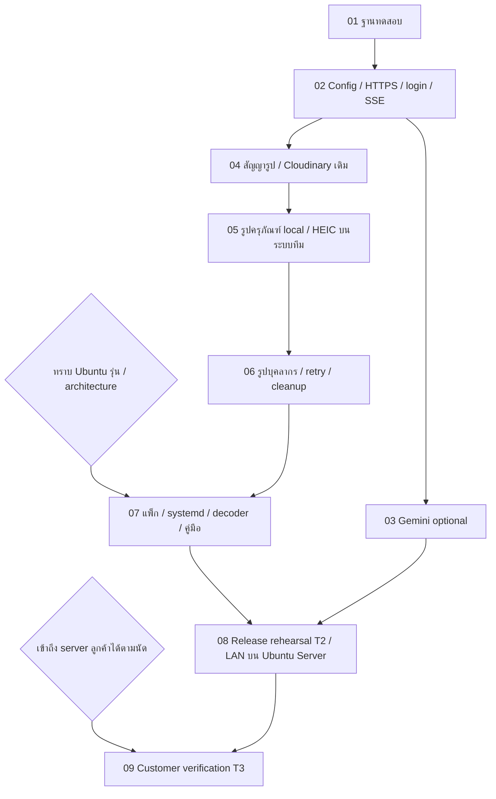

# แผนแบ่ง Ticket: Customer Server Refactor

สถานะ: ปรับข้อมูล OS ตามคำยืนยันเมื่อ 2026-10-19 คง 9 ticket และสร้างไฟล์งานที่แก้ไขแล้วครบ

อ้างอิง: [Spec ต้นทาง](../../backend/.scratch/customer-server-refactor/spec.md) · [สารบัญ ticket ล่าสุด](../../backend/.scratch/customer-server-refactor/map.md)

## เหตุผลที่ปรับลำดับ

ลูกค้ายืนยันใช้ Ubuntu Server และกำลังเตรียมการเข้าถึงผ่าน SSH แต่ยังต้องทราบรุ่นและสถาปัตยกรรมของเครื่องจริง ให้ทำส่วนแอปที่ตรวจบนระบบทีมได้ก่อน และแยกเงื่อนไขรู้รุ่นเครื่องออกจากเงื่อนไขเข้าถึงเครื่องจริง งานนี้คงขอบเขต D1–D9 และจำนวน 9 ticket จากชุดที่อนุมัติไว้

spec ต้นทางและ ticket ได้ปรับจากสมมติฐาน Windows ตามข้อมูลแรกมาเป็น Ubuntu Server แล้ว การส่งมอบต้องรับรอง Ubuntu Server รุ่น/สถาปัตยกรรมที่ตรงกับเครื่องลูกค้า ไม่อนุมานว่าผลจาก Windows หรือ Ubuntu รุ่นอื่นใช้แทนกันได้

## ภาพรวมลำดับใหม่

| Ticket | งาน | Blocked by | ขอบเขตระหว่างรอรุ่นเครื่อง |
| --- | --- | --- | --- |
| 01 | [แยกฐานข้อมูลทดสอบและป้องกันการรันผิดเป้าหมาย](../../backend/.scratch/customer-server-refactor/issues/01-safe-test-database.md) | None | ทำและตรวจบนระบบทีมได้ |
| 02 | [ตรวจค่าตั้งและเปิดเว็บที่ host เองผ่าน HTTPS](../../backend/.scratch/customer-server-refactor/issues/02-config-and-self-hosted-https.md) | 01 | ทำและตรวจบนระบบทีมได้ |
| 03 | [ปิด Gemini ได้โดยข้อมูลย้อนหลังยังใช้งานได้](../../backend/.scratch/customer-server-refactor/issues/03-optional-gemini-forecast.md) | 02 | ทำและตรวจบนระบบทีมได้ |
| 04 | [ใช้สัญญารูปที่ไม่ผูก Cloudinary โดย flow เดิมยังทำงาน](../../backend/.scratch/customer-server-refactor/issues/04-provider-neutral-image-contract.md) | 02 | ทำและตรวจบนระบบทีมได้ |
| 05 | [จัดการรูปครุภัณฑ์ภายในครบทุกชนิด รวม HEIC/HEIF](../../backend/.scratch/customer-server-refactor/issues/05-local-asset-images-and-heic.md) | 04 | ทำแอปและทดสอบไฟล์จริง; Ubuntu Server ตรวจใน 07 |
| 06 | [จัดการรูปบุคลากรและกู้สถานะรูปเมื่อเกิดข้อขัดข้อง](../../backend/.scratch/customer-server-refactor/issues/06-private-employee-photos-and-image-recovery.md) | 05 | ทำแอปและทดสอบไฟล์จริง; Ubuntu Server ตรวจใน 07 |
| 07 | [แพ็กและติดตั้ง production บน Ubuntu Server พร้อมคู่มือดูแลระบบ](../../backend/.scratch/customer-server-refactor/issues/07-target-os-production-package-and-operations-guide.md) | 06 | รอรุ่น/architecture; ใช้ Ubuntu VM ทีมได้ |
| 08 | [ซ้อม release บน Ubuntu Server ที่สะอาด รวมใช้งานผ่าน LAN](../../backend/.scratch/customer-server-refactor/issues/08-target-os-release-rehearsal-and-lan.md) | 03, 07 | รอรุ่น/architecture; ใช้ Ubuntu VM ทีมได้ |
| 09 | [ตรวจ server ลูกค้าและความพร้อมก่อนเปิดใช้งานจริง](../../backend/.scratch/customer-server-refactor/issues/09-customer-server-readiness.md) | 08 | ตรวจเมื่อเข้าถึงเครื่องลูกค้าได้ |

## ลำดับเริ่มและจุดรอ

1. เริ่ม 01 เพื่อให้การรันชุดทดสอบไม่เขียนผิดฐาน แล้วทำ 02 ให้ configuration และ HTTPS บนระบบทีมพร้อม
2. ทำ 03 เปิด–ปิด Gemini ก่อนหรือขนานกับ 04 ได้โดยไม่ต้องรอการจัดการรูป
3. ทำสายงานรูป 04 → 05 → 06 ใช้ฐานและไฟล์จริงบนระบบทีม คงการอ่านรูป สิทธิ์ normalization/HEIC และ fault safety ตาม spec
4. เมื่อ 06 ผ่านและทราบ Ubuntu Server รุ่น/architecture จึงทำ 07 เลือกชุดแพ็ก ตรวจ HEIC/permissions ภายใต้ service account จริง และทำคู่มือ
5. ทำ 08 หลัง 03 และ 07 เพื่อซ้อมชุดส่งมอบบน Ubuntu Server ที่สะอาด รวม LAN ที่ไม่มี public Internet
6. ทำ 09 หลัง 08 เมื่อเข้าถึงเครื่องลูกค้าได้ตามช่องทางที่อนุญาตและเวลานัด เพื่อยืนยันสภาพแวดล้อมจริง

รุ่นและสถาปัตยกรรม Ubuntu Server เป็นเงื่อนไขก่อนแพ็กและตรวจรับ 07–08 ส่วน SSH หรือช่องทางดูแลเครื่องจริงเป็นเงื่อนไขภายนอกของ 09 การรอเงื่อนไขท้ายงานไม่ขวางการทำ 01–06

## Blocking graph

## การปรับเลขจากชุดก่อน

| เลขก่อนปรับครั้งนี้ | เลขใหม่ | งาน |
| --- | --- | --- |
| 01 | 01 | แยกฐานข้อมูลทดสอบและป้องกันการรันผิดเป้าหมาย |
| 02 | 02 | ตรวจค่าตั้งและเปิดเว็บที่ host เองผ่าน HTTPS |
| 06 | 03 | ปิด Gemini ได้โดยข้อมูลย้อนหลังยังใช้งานได้ |
| 03 | 04 | ใช้สัญญารูปที่ไม่ผูก Cloudinary โดย flow เดิมยังทำงาน |
| 04 | 05 | จัดการรูปครุภัณฑ์ภายในครบทุกชนิด รวม HEIC/HEIF |
| 05 | 06 | จัดการรูปบุคลากรและกู้สถานะรูปเมื่อเกิดข้อขัดข้อง |
| 07 | 07 | แพ็กและติดตั้ง production บน Ubuntu Server พร้อมคู่มือดูแลระบบ |
| 08 | 08 | ซ้อม release บน Ubuntu Server ที่สะอาด รวมใช้งานผ่าน LAN |
| 09 | 09 | ตรวจ server ลูกค้าและความพร้อมก่อนเปิดใช้งานจริง |

## ขอบเขตและเกณฑ์ของแต่ละ Ticket

### 01 — แยกฐานข้อมูลทดสอบและป้องกันการรันผิดเป้าหมาย

**Blocked by:** None (can start immediately).

**ผลที่ตรวจได้:** ผู้พัฒนารันการตรวจที่ต้องเขียนข้อมูลได้บนฐานทดสอบอย่างตั้งใจ และค่าตั้งที่ผิดถูกปฏิเสธก่อนแอปเปิด connection

**Environment:** ทำและตรวจบนระบบทดสอบทีมได้ก่อนสรุป OS ของลูกค้า

- ครอบคลุมทุกทางเข้าชุดทดสอบที่เขียนข้อมูลและเกี่ยวข้องกับ scope นี้ รวม service suites ที่ใช้ shared Prisma และ generic runners ไม่อาศัย guard เฉพาะ auth-integration ว่าครอบคลุมทั้งหมด
- ตรวจปลายทางฐานข้อมูลจริงก่อน import แอป ใช้ dedicated test DB และไม่ยอมให้ fallback ไปฐานปกติจากค่าตั้งในเครื่อง
- พิสูจน์ทั้งกรณีปฏิเสธโดยไม่มีการเขียนข้อมูล และกรณีรัน integration ที่ถูกต้องบนฐานแยก
- บันทึก baseline build/ชุดตรวจที่เกี่ยวข้อง พร้อมบอกว่าส่วนใดใช้ mock หรือถูก skip

### 02 — ตรวจค่าตั้งและเปิดเว็บที่ host เองผ่าน HTTPS

**Blocked by:** 01.

**ผลที่ตรวจได้:** ค่าตั้งที่ถูกต้องเปิด frontend/backend production build ผ่าน HTTPS ที่ทีม host เอง และใช้บัญชีทดสอบผ่าน proxy จาก browser อีกเครื่องได้ ส่วนค่าที่ขาดหรือผิดถูกปฏิเสธก่อน DB/auth/mail เริ่มทำงาน

**Environment:** ทำและตรวจบนระบบทดสอบทีมได้ก่อนสรุป OS ของลูกค้า

- รวม configuration contract และลำดับ validation ก่อน import-time side effects ที่เกี่ยวข้อง
- คงการรัน cloud เดิมและกฎ auth/SMTP/secret พร้อมออกแบบ provider/feature configuration ให้แต่ละ slice เพิ่มการตรวจเฉพาะตัวได้
- ตรวจเฉพาะค่าจำเป็นตามบริการที่เลือก ไม่บังคับ credentials ของบริการที่ไม่ได้เลือก และไม่คืน secret ไป frontend/log
- ไม่สร้างฟอร์มตั้งค่า deployment ในแอปหรือทำ hot-switch provider ของข้อมูลจริง
- ตรวจผ่านการเริ่มแอปและ HTTP behavior ที่สังเกตได้ พร้อมกรณี invalid configuration
- คง same-origin API, secure host-only cookies, role/2FA, session restore/sign-out, CSRF และ trusted origins
- เปิด deep link/refresh หน้าได้และ notification SSE ทำงานจริงผ่าน proxy
- แยกชื่อระบบ ข้อมูลและ key ของสภาพแวดล้อมทดสอบ ไม่ใช้ port ต่างกันเป็นหลักฐานแยก session/data เพียงอย่างเดียว
- มี browser-driven acceptance ที่ขอบเขต deployed HTTPS ใช้ auth/session และ PostgreSQL จริง เป็นฐานสำหรับ slice ถัดไป
- บันทึก OS/runtime และ configuration ของระบบทดสอบทีมที่ผ่าน โดยให้ ticket 07–09 ตรวจชุดติดตั้งและสภาพแวดล้อมเป้าหมายเมื่อได้ข้อสรุปจากลูกค้า
- แยกค่าตั้งและพฤติกรรมของแอปจากวิธีติดตั้งและเริ่ม service ของ OS เพื่อให้ตรวจ core flow ได้โดยไม่ต้องเข้าถึง server ลูกค้า

### 03 — ปิด Gemini ได้โดยข้อมูลย้อนหลังยังใช้งานได้

**Blocked by:** 02.

**ผลที่ตรวจได้:** เปิดหน้ารายจ่ายแล้วเห็น Expense History และ Asset Lifespan Analysis ได้แม้ปิด Gemini และสถานะไม่มีผลพยากรณ์สื่อถูกต้อง

**Environment:** ทำและตรวจบนระบบทดสอบทีมได้ก่อนสรุป OS ของลูกค้า

- ค่าตั้งลูกค้าปิด Gemini เป็นค่าเริ่มต้น การมี key อย่างเดียวไม่เปิดส่งข้อมูล
- แยก disabled/insufficient/unavailable/available ใน API และ UI ไม่แสดงผลว่างเป็นคำทำนายศูนย์บาท
- เมื่อเปิดอย่างชัดเจนและมีสิทธิ์/ค่าตั้งครบจึงเรียก provider พร้อมขอบเขต timeout
- การเรียกไม่สำเร็จไม่ทำให้ข้อมูลย้อนหลังและอายุครุภัณฑ์หายไป
- ตรวจ browser behavior และ HTTP response รวมหลักฐานว่า disabled ไม่ส่งคำขอออก ไม่เพิ่มโมเดลทำนายภายใน

### 04 — ใช้สัญญารูปที่ไม่ผูก Cloudinary โดย flow เดิมยังทำงาน

**Blocked by:** 02.

**ผลที่ตรวจได้:** ผู้ใช้จัดการ Asset Images และ Employee Photos บนรูปแบบ cloud ผ่านสัญญาที่แยก transport/proof ของ provider แล้วได้ครบตามเดิม

**Environment:** ทำและตรวจบนระบบทดสอบทีมได้ก่อนสรุป OS ของลูกค้า

- ปรับข้อตกลงระหว่าง UI, upload instructions, verification และ record attachment ให้ Cloudinary details อยู่หลัง storage boundary
- คง ownership/purpose/target validation, preview, public asset versioning, Employee Photo grants และ cleanup ที่มีอยู่
- Frontend ไม่ส่ง HAMS credentials/CSRF ไป provider ภายนอก และไม่ขยาย URL allowlist เป็นการรับทุก URL
- ใช้วิธีเพิ่ม/ย้ายสัญญาโดยให้การเรียกเดิมที่ยังต้องรองรับทำงานต่อจนเปลี่ยนครบ ไม่ทิ้งขั้นกลางที่ทำให้ CI หรือ cloud flow เดิมเสีย
- ยืนยันผ่าน browser/HTTP behavior และ provider contract ที่เกี่ยวข้อง รายงานกรณีที่ยังใช้ provider จำลองอย่างชัดเจน

### 05 — จัดการรูปครุภัณฑ์ภายในครบทุกชนิด รวม HEIC/HEIF

**Blocked by:** 04.

**ผลที่ตรวจได้:** ผู้มีสิทธิ์เลือกรูป JPEG/PNG/static WebP/HEIC/HEIF บนฟอร์มครุภัณฑ์ แปลง ดู preview บันทึก เปิดอ่าน และเปลี่ยนรูปภายในได้จริงบนระบบทดสอบทีม โดยให้ ticket 07 ตรวจชุดแพ็กบน Ubuntu Server

**Environment:** ทำส่วนแอปและตรวจด้วยไฟล์จริงบนระบบทดสอบทีมได้; การรับรองชุดแพ็กและสิทธิ์ service บน Ubuntu Server อยู่ใน ticket 07

- เพิ่ม local provider ที่ตั้งตำแหน่งโฟลเดอร์ข้อมูลนอกโปรแกรมได้ โดยไม่ต้องใส่ Cloudinary credentials และมี storage identity คงที่
- รับ JPEG/PNG/static WebP/HEIC/HEIF ตรวจ actual content, size/pixels, trusted upload identity และขอบเขต filesystem
- Normalize ตามนโยบาย Asset Image: JPEG quality 80, ด้านยาว 1,600, ไม่ขยายภาพเล็ก, orientation/พื้นขาว/metadata ตาม spec
- ครอบคลุม UI → local upload → verify → persist/attach → public versioned read โดยไม่ใช้ mock แทนไฟล์จริง
- รักษารูปเดิมเมื่อบันทึก/แปลงล้มเหลว และมี local delete/cleanup ที่ไม่ลบ active attachment ตั้งแต่ slice แรก
- เลือก decoder จากหลักฐานการทดลองกับ OS/runtime ของระบบทดสอบทีม และเก็บการแปลงไว้หลังขอบเขตที่เปลี่ยน implementation ได้ การรับรองชุดแพ็กบน Ubuntu Server ต้องผ่าน ticket 07
- ไฟล์ decoder ที่ใช้ทดสอบอยู่ภายในชุดทดสอบ ไม่โหลดจาก CDN และไม่พึ่ง working directory ของผู้พัฒนา ตรวจความครบของชุดส่งมอบบน Ubuntu Server อีกครั้งใน ticket 07
- คง 10,000,000 bytes / 25,000,000 pixels พร้อมขอบเขต memory/time/concurrency และไม่ block งานหลัก
- ตรวจ orientation/mirroring, primary image, transparency/color และผล normalization ของตัวอย่าง HEIC ที่เหมาะสม
- โครง normalization ใช้ต่อสำหรับ Employee Photo ด้วย policy 512 pixels ได้ โดยไม่ต้อง decode ผ่าน browser
- บันทึกผลจริงและข้อจำกัด หาก candidate ไม่ผ่านให้เปลี่ยนแนวทาง ไม่ตัด HEIC ออกโดยปริยาย
- ตั้งตำแหน่งโฟลเดอร์ข้อมูลและพื้นที่ชั่วคราวได้ ใช้การจัดการ path และ filesystem ที่ไม่ผูกอักษรไดรฟ์ ตัวคั่น path หรือคำสั่ง shell ของ OS หนึ่ง พร้อมรักษาขอบเขต path และ storage identity
- บันทึก OS/runtime และผลแปลงไฟล์จริงที่ทดสอบในขั้นนี้ เพื่อใช้เทียบกับชุดส่งมอบเป้าหมาย โดยไม่อนุมานการรองรับอีก OS จากผลนี้

### 06 — จัดการรูปบุคลากรและกู้สถานะรูปเมื่อเกิดข้อขัดข้อง

**Blocked by:** 05.

**ผลที่ตรวจได้:** ADMIN จัดการ Employee Photo ภายในได้ครบทุกชนิดไฟล์ที่ตกลง ผู้มีสิทธิ์อ่านผ่าน grant ชั่วคราว และทั้ง Asset Image/Employee Photo คงรูปปัจจุบันได้เมื่อ retry การตอบกลับสูญหาย แก้ไขชนกัน หรือ cleanup บนระบบทดสอบทีม

**Environment:** ทำส่วนแอปและตรวจด้วยไฟล์จริงบนระบบทดสอบทีมได้; การรับรองชุดแพ็กและสิทธิ์ service บน Ubuntu Server อยู่ใน ticket 07

- ครอบคลุมเลือก/preview/บันทึก/เปลี่ยนรูปจริงบน UI พร้อม policy JPEG 512 pixels และขอบเขต input เดิม
- Pending preview ให้ขอได้เฉพาะเจ้าของ upload และต้องไม่กลายเป็นไฟล์ public
- คงกฎผู้มีสิทธิ์อ่านเดิม ไม่เพิ่มเงื่อนไข owner-only/ADMIN-only สำหรับการอ่านโดยไม่มีข้อตกลง
- ออก grant อายุเริ่มต้นห้านาที ไม่มี permanent public URL และคำขออ่านใหม่จากลิงก์หมดอายุถูกปฏิเสธ
- คง no-store และ account/session/revision-scoped memory cache ที่ล้างเมื่อ logout/สลับบัญชี/เปลี่ยนรูป
- พิสูจน์ HTTPS/browser ด้วย local byte reads จริง และคง cloud Employee Photo behavior
- ใช้ทั้ง Asset Images และ Employee Photos พร้อม local filesystem จริง และรักษา cloud contracts
- จำลอง commit สำเร็จแต่ response สูญหาย บันทึกไม่สำเร็จ cancel/abandon/pending expiry และ retry
- ยืนยัน last-write-wins ที่ปลอดภัยและการตัดสินรูปที่ถูกแทน ณ commit ไม่เชื่อรูปเก่าจากฟอร์มที่ค้าง
- กรณี concurrent attachment/cleanup ไม่ลบ active reference และไม่ทิ้งงานลบในสถานะที่กู้ต่อไม่ได้
- เพิ่มหรือแก้ behavior เฉพาะที่กรณี fault เปิดเผย โดยใช้ existing lifecycle seam ไม่สร้าง storage/lifecycle subsystem ใหม่
- ตรวจ lifecycle ด้วยฐานและไฟล์จริงบนระบบทดสอบทีม ใช้พื้นที่ข้อมูลจาก configuration และให้ ticket 07 ตรวจสิทธิ์ filesystem ภายใต้บัญชี service ของ Ubuntu Server

### 07 — แพ็กและติดตั้ง production บน Ubuntu Server พร้อมคู่มือดูแลระบบ

**Blocked by:** 06.

**ผลที่ตรวจได้:** ติดตั้งชุด production บน Ubuntu Server ทดสอบที่สะอาดและตรงกับรุ่น/สถาปัตยกรรม/runtime ของลูกค้า เปิดเว็บด้วย ADMIN ทดสอบที่ผ่านอีเมล/2FA และ reboot แล้วใช้ข้อมูลเดิมได้ พร้อมคู่มืออัปเดต ย้อนกลับ และกู้คืนที่ตรงกับชุดติดตั้ง

**Environment:** ตรวจบน Ubuntu Server รุ่นและสถาปัตยกรรมเดียวกับเป้าหมายตาม Prerequisites

**Prerequisites:** ลูกค้ายืนยันใช้ Ubuntu Server; ต้องทราบรุ่น สถาปัตยกรรม และข้อจำกัดการติดตั้งก่อนรับรองชุดแพ็ก ใช้ Ubuntu Server VM ของทีมที่ตรงเป้าหมายได้ จึงไม่ต้องรอ SSH ของเครื่องลูกค้าเพื่อเริ่มขั้นนี้

- แพ็ก runtime, generated client, image processor/decoder และ provisioning tools ที่ใช้จริงให้ครบ ไม่พึ่ง development checkout
- บันทึก Ubuntu Server รุ่น สถาปัตยกรรม runtime และวิธีรันเป็น service ที่ตรวจได้ ใช้บัญชี service แบบไม่ใช่ root และตั้งเริ่มอัตโนมัติผ่าน systemd หรือกลไก service ของชุดติดตั้ง โดยไม่ผูก Docker เป็นข้อบังคับล่วงหน้า
- ระบุ base-server prerequisites ที่จำเป็น เช่น OpenSSH Server, package repository หรือชุดติดตั้ง offline และ reverse proxy; Featured Server Snaps รวม PowerShell ไม่ใช่ dependency ของ HAMS
- เตรียมฐานใหม่ด้วย production migrations/reference seed ตามขั้นตอนเดิม ไม่ปน demo seed
- ใช้ SMTP ทดสอบที่ส่งจริงและผ่าน TLS policy พร้อม bootstrap ADMIN ทดสอบสองบัญชี ยืนยันอีเมล/enroll 2FA และผ่าน handover gate
- รันผ่านบัญชี service/working directory จริง ตั้งเริ่มหลัง reboot และคง DB/รูป/identity/key
- มี readiness DB/storage แบบมีขอบเขต ไม่ส่งอีเมลหรือเรียก Gemini ในทุก probe และไม่เผย secret ในรายงาน
- นี่คือ package และ install path ที่ใช้ซ้ำในการตรวจรวมภายหลัง ไม่ใช่การอนุมัติเปิดระบบลูกค้า
- ระบุ DB, รูป, configuration/key และความสอดคล้องที่ต้องรักษา รวมผู้รับผิดชอบ ช่วงพักใช้งาน และเกณฑ์เปิดระบบอีกครั้ง
- อธิบายการรอธุรกรรม หยุดแอป/cleanup อัปเดต และตรวจว่าข้อมูล/รูป/keys เดิมยังใช้งานได้
- คู่มือ rollback ไม่เท่ากับย้อน schema อัตโนมัติหรือทับข้อมูลใหม่ด้วย backup เก่า
- ระบุวิธีซ้อมคืนในปลายทางแยกและตรวจ login/2FA/รูป โดย IT ใช้เครื่องมือที่เลือก ไม่สร้าง backup scripts/scheduler/service ใหม่
- ทบทวนคู่มือด้วยข้อมูล test installation และบันทึกสิ่งที่ทดลองจริงกับสิ่งที่ยังรอเครื่องมือ/ข้อกำหนดจาก IT
- RPO/RTO, retention, ปลายทางและความถี่จริงเป็นค่าที่ต้องตกลงก่อน go-live ไม่สมมติตัวเลขแทนลูกค้า
- ตรวจ HEIC/HEIF และ normalization ทุกชนิดไฟล์ด้วยชุดแพ็กจริงบน Ubuntu Server ภายใต้บัญชี service หากต่างจากระบบทดสอบทีมให้ปรับ adapter หรือการแพ็กและตรวจซ้ำก่อนผ่าน โดยคงข้อตกลงรูปเดิม
- ตรวจ owner/group/mode ของโฟลเดอร์ข้อมูลและพื้นที่ชั่วคราว รวม identity/key ภายใต้บัญชี service บน Ubuntu Server พร้อมยืนยันว่าพื้นที่ข้อมูลแยกจาก source และ release

### 08 — ซ้อม release บน Ubuntu Server ที่สะอาด รวมใช้งานผ่าน LAN

**Blocked by:** 03, 07.

**ผลที่ตรวจได้:** มีรายงาน T2 ของชุดที่จะส่งมอบบน Ubuntu Server รุ่น/สถาปัตยกรรม/runtime ที่ตรงกับลูกค้า ตรวจ clean install, auth/SMTP/รูป/ภาวะขัดข้อง/อัปเดต/กู้คืน รวมงานหลักจากอีกเครื่องใน LAN เมื่อปิด Gemini และปิดการออกอินเทอร์เน็ตสาธารณะหลัง setup และเปิดบัญชี

**Environment:** ตรวจบน Ubuntu Server รุ่นและสถาปัตยกรรมเดียวกับเป้าหมายตาม Prerequisites

**Prerequisites:** มี Ubuntu Server รุ่น/architecture/runtime เป้าหมายและชุดติดตั้งจาก ticket 07; ใช้เครื่องหรือ VM ทดสอบที่ตรงกันและ browser อีกเครื่องได้ โดยยังไม่ต้องเข้าถึงเครื่องลูกค้า

- เสิร์ฟ frontend/font ภายในหรือใช้ system font และแก้ external runtime dependencies ของ core flow ที่ตรวจพบ
- ทดสอบ browser ผ่าน HTTPS จากอีกเครื่องด้วยข้อมูลและไฟล์จริง ไม่ใช่เฉพาะ localhost
- ตรวจว่ารูปของ local installation ไม่วิ่งออก Cloudinary และหน้าเว็บไม่ขอ Google Fonts
- LAN, DB และบริการภายในยังอยู่ระหว่างทดสอบ ไม่ตัดเครือข่ายทั้งหมดแล้วตีความเป็น offline core
- การส่ง SMTP ภายนอกและ Gemini ที่เปิดใช้ตรวจแยกตามเส้นทางที่ได้รับอนุญาต ไม่อ้างว่าทำงานได้เมื่อเส้นทางขาด
- ใช้ artifact/revision ที่บันทึกไว้และติดตั้งใหม่บน Ubuntu Server ที่สะอาด ไม่พึ่งไฟล์ตกค้างจากเครื่องทีม
- ตรวจ systemd/service startup, log และ graceful stop/restart ภายใต้บัญชี service จริง รวมการเริ่มอัตโนมัติหลัง reboot
- ตรวจ auth/roles/2FA/SMTP, รูปทุกชนิดและสิทธิ์, grant expiry, recovery/cleanup faults, Gemini states, LAN, SSE และ reboot
- ซ้อม upgrade บนข้อมูลเดิมและใช้คู่มือ rollback/recovery ร่วมกับเครื่องมือที่ IT เลือกในปลายทางทดสอบแยก
- มี cloud regression/provider evidence สำหรับ behavior ที่คงไว้ รายงาน mock และ skip แยกจากผลจริง
- วัดภาระงานและ image-processing resources ตามเป้าหมายที่ตกลงไว้ก่อนรัน ไม่รับรอง capacity ที่ยังไม่วัด
- รายงาน pass/fail/skip, OS/runtime, artifact identity และข้อจำกัดที่ยังไม่ทดสอบอย่างชัดเจน ปัญหางานหลัก/สิทธิ์ต้องแก้ก่อนผ่าน

### 09 — ตรวจ Ubuntu Server ลูกค้าและความพร้อมก่อนเปิดใช้งานจริง

**Blocked by:** 08.

**ผลที่ตรวจได้:** มีผล T3 จากเครื่องและเครือข่ายลูกค้า พร้อม handover ผู้ดูแลจริงและข้อสรุปเปิดใช้งานจากข้อมูลที่ตรวจแล้ว

**Environment:** ตรวจบน Ubuntu Server และเครือข่ายจริงของลูกค้าตาม Prerequisites

**Prerequisites:** ลูกค้ายืนยันใช้ Ubuntu Server และให้เข้าถึงเครื่องผ่าน OpenSSH หรือช่องทางที่อนุญาต พร้อมสิทธิ์ sudo, เครือข่าย DNS/HTTPS/SMTP และช่วงเวลาตรวจ ก่อนเริ่ม T3

- ยืนยัน Ubuntu Server version/architecture/runtime, hostname/timezone/NTP, สถานะ OpenSSH, สิทธิ์ sudo และบัญชี service, data directory, DNS/HTTPS/firewall/proxy และ SMTP จริง
- ตรวจ static IP หรือ DHCP reservation, SSH port และแหล่งเครือข่ายที่ได้รับอนุญาต โดยไม่บันทึก password/private key ลงรายงาน
- ใช้ชุดที่ผ่าน T2 หากเปลี่ยน package/runtime ให้ตรวจผลกระทบและชุดที่เปลี่ยนก่อนอ้างความพร้อม
- เปิดจากเครื่องเจ้าหน้าที่อีกเครื่องและตรวจงานหลัก รูป HEIC/สิทธิ์ session/2FA, SSE, LAN และการเริ่มระบบตามแผนที่นัดหมาย
- เตรียม production ใหม่และ handover ADMIN จริงสองบัญชีที่ verified/enrolled โดยไม่ปนข้อมูลทดสอบ
- ยืนยัน IT รับคู่มือ/เลือกเครื่องมือสำรอง และช่วงดูแลระบบนอกเวลาราชการตามนัด
- ยังเปิดจริงไม่ได้หาก SMTP ใช้งานจริงไม่ได้ หรือมีปัญหาค้างที่ทำให้งานหลัก/สิทธิ์ผิด การปิด Gemini ตามข้อตกลงไม่ใช่ความล้มเหลว
- ต้องมีการเข้าถึงเครื่อง ข้อมูลสภาพแวดล้อม ปลายทางทดสอบ และช่วงเวลาจากลูกค้าจริง เป็น external prerequisites ของการตรวจ T3 ไม่ใช่ผลที่อนุมานจาก VM ของทีม
- การเผยแพร่ ticket ไม่ได้เป็นการอนุญาตหยุดเครื่อง ส่งอีเมล production หรือแก้ข้อมูลจริงในขณะนี้

## สถานะ

- อัปเดตไฟล์แยกทั้ง 9 ticket พร้อมเลข ลิงก์ และ dependencies ให้ตรงกับลำดับนี้
- แยกผลทดสอบระบบทีมกับการรับรองชุดส่งมอบบน Ubuntu Server ไม่ย้ายการตรวจรายฟีเจอร์ไปรอท้ายงาน
- งานนี้เป็นการปรับเอกสารและ ticket ยังไม่ได้เริ่ม implementation หรือรันทดสอบ deploy
